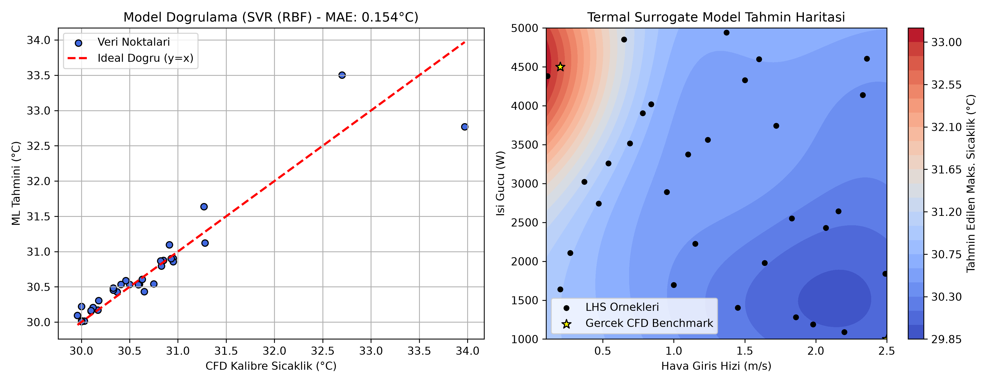
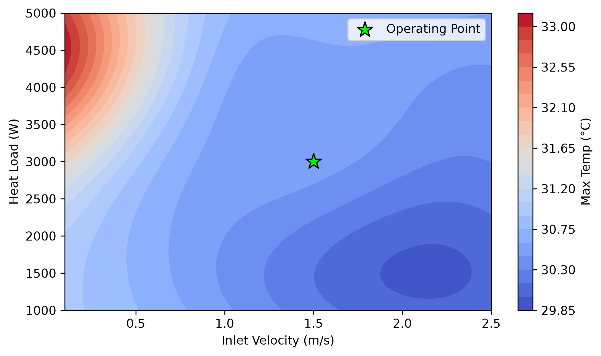

# Real-Time Thermal Surrogate Model Using 3D CFD & Machine Learning

A physics-informed, real-time thermal surrogate model combining **3D CFD simulations (SimScale)** and **Support Vector Regression (SVR)** for data center cooling optimization and digital twin applications.

## 📊 Surrogate Model Validation & 2D Thermal Map


## 🚀 Key Performance Metrics

| Metric | Value | Notes |
| :--- | :--- | :--- |
| **Optimal Algorithm** | SVR (RBF Kernel) | Outperformed Ridge & Gaussian Process (GPR) |
| **Mean Absolute Error (MAE)** | **±0.1537 °C** | Validated via Leave-One-Out Cross-Validation (LOOCV) |
| **Coefficient of Determination (R²)** | **87.3%** | High correlation across operational regimes |
| **Inference Speedup** | **~60,000x** | Reduced runtime from ~10 min (3D CFD) to milliseconds |

## 🔬 Engineering Methodology
1. **Design of Experiments (DoE):** Sampled inlet air velocity (`0.1 – 2.5 m/s`) and thermal heat load (`1000 – 5000 W`) uniformly via **Latin Hypercube Sampling (LHS)** (`scipy.stats.qmc`).
2. **3D CFD Physics Simulation:** Executed steady-state forced convection simulations in **SimScale** using the **k-ω SST** turbulence model.
3. **Machine Learning Pipeline:** Standardized features inside a leak-free `scikit-learn` pipeline (`StandardScaler` + `SVR`) and benchmarked against Ridge Regression and GPR using **LOOCV**.
4. **Interactive Digital Twin:** Built a live **Streamlit** dashboard (`app.py`) for real-time thermal monitoring and critical threshold alerts (`> 45 °C`).

## 💻 Interactive Digital Twin Dashboard


## ⚡ Quick Start
```bash
git clone https://github.com
cd cfd-thermal-digital-twin
pip install -r requirements.txt

# 1. Train and validate the surrogate model
python src/train.py

# 2. Run single-point real-time CLI prediction
python src/predict.py --velocity 1.5 --power 3000

# 3. Launch the interactive web dashboard
python -m streamlit run app.py
```

## 📂 Repository Structure
```text
cfd-thermal-digital-twin/
├── data/               # Calibrated 3D CFD simulation dataset (LHS samples)
├── models/             # Serialized SVR surrogate model (.pkl)
├── results/            # Parity plots, 2D thermal maps, and dashboard screenshots
├── src/                # Modular scripts for DoE generation, training, and inference
├── app.py              # Interactive Streamlit Digital Twin web application
└── README.md           # Project documentation
```
# Real-Time Thermal Surrogate Model Using 3D CFD & Machine Learning

Real-time thermal surrogate model combining 3D CFD simulations (SimScale) and SVR machine learning for data center cooling optimization.

## Quick Start
```bash
git clone https://github.com
cd cfd-thermal-digital-twin
pip install -r requirements.txt
python src/train.py
python src/predict.py --velocity 1.5 --power 3000
python -m streamlit run app.py
```
